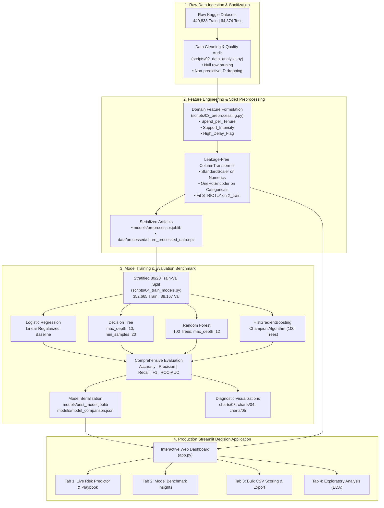

# 🛡️ Customer Churn Intelligence & Risk Forecasting System
### *An End-to-End Enterprise Machine Learning Pipeline, Leakage-Free Preprocessing Architecture, Multi-Model Benchmark, and Prescriptive Streamlit Decision Support Application*

[](https://www.python.org/)
[](https://scikit-learn.org/)
[](https://streamlit.io/)
[](https://pandas.pydata.org/)
[](https://numpy.org/)
[]()

---

## 👨‍💻 Developer & Author Profile

**Kalindu Mihiranga Silva**  
*2nd-Year BSc (Hons) in Data Science & Business Analytics Student*  
**General Sir John Kotelawala Defence University (KDU), Sri Lanka**  
*Aspiring AI & Machine Learning Engineer*  

- **GitHub**: [github.com/kalinduusilva](https://github.com/kalinduusilva)
- **LinkedIn**: [linkedin.com/in/kalindusilva](https://www.linkedin.com/in/kalindusilva/)
- **Project Repository**: [Customer Churn Prediction System](https://github.com/kalinduusilva/customer-churn-prediction)

---

## 📖 Executive Summary & Personal Project Context

As a 2nd-year undergraduate in Data Science & Business Analytics at General Sir John Kotelawala Defence University, I developed this project to demonstrate how modern machine learning principles translate directly into high-impact commercial decision systems. Rather than building a toy classifier or training on trivial sample sizes, I architected this solution on a dataset exceeding **500,000+** customer records (440,833 training samples and 64,374 external test records).

My primary objective was to treat customer churn not as an isolated statistical classification exercise, but as a holistic end-to-end data product:
1. **Preventing subtle data leakage** by strictly isolating transformers to the training distribution.
2. **Injecting business intuition** through three carefully designed domain-engineered features.
3. **Rigorous benchmarking** of linear, tree, bagging, and boosting algorithms.
4. **Delivering actionable business intelligence** via a modern, interactive Streamlit decision-support application equipped with dynamic feature calculation and prescriptive retention playbooks.

---

## 📌 Table of Contents

- [Business Motivation & Economic Impact](#-business-motivation--economic-impact)
- [End-to-End System Architecture](#-end-to-end-system-architecture)
- [Repository File Structure](#-repository-file-structure)
- [Exploratory Data Analysis (EDA) & Behavioral Discoveries](#-exploratory-data-analysis-eda--behavioral-discoveries)
- [Leakage-Free Preprocessing Pipeline](#-leakage-free-preprocessing-pipeline)
- [Domain-Specific Feature Engineering](#-domain-specific-feature-engineering)
- [Multi-Model Benchmarking & Champion Selection](#-multi-model-benchmarking--champion-selection)
- [Interactive Streamlit Web Dashboard](#-interactive-streamlit-web-dashboard)
- [Step-by-Step Local Execution Guide](#-step-by-step-local-execution-guide)
- [Undergraduate Data Science Takeaways & Lessons Learned](#-undergraduate-data-science-takeaways--lessons-learned)
- [License & Data Attribution](#-license--data-attribution)

---

## 💼 Business Motivation & Economic Impact

In SaaS, telecommunications, and recurring subscription business models, **customer churn is the primary destroyer of enterprise value and Customer Lifetime Value (CLV/LTV)**. 

### Why Retention Dominates Acquisition:
* **The Acquisition Multiplier**: Industry research consistently proves that acquiring a new customer costs **5x to 7x more** than retaining an existing one. High acquisition costs (CAC) erode operating margins when customers cancel before reaching payback break-even.
* **Profit Leverage**: According to classic research by Bain & Company and Harvard Business School, increasing customer retention rates by just **5%** increases overall profits by **25% to 95%**, because returning customers spend more, refer others, and require lower servicing overhead.
* **Proactive Intervention vs. Reactive Exit**: Traditional customer success teams are purely reactive—they discover a customer is dissatisfied only when a cancellation ticket is formally submitted. By that point, the churn decision is irreversible. 

### What This System Achieves:
This system flips the paradigm from reactive firefighting to **predictive and prescriptive risk mitigation**. By evaluating subtle shifts in usage frequency, payment delays, support ticket escalation, and tenure-spend velocity, the model flags at-risk accounts weeks before cancellation occurs and generates tailored countermeasures to preserve recurring revenue.

---

## 🏗️ End-to-End System Architecture

The following diagram illustrates the complete modular lifecycle I engineered, spanning raw ingestion, strict train-only fitting, cross-model benchmarking, and real-time dashboard deployment:



---

## 📂 Repository File Structure

```text
Customer Churn Prediction System/
│
├── archive/                                      # Raw Kaggle customer datasets (git-ignored)
│   ├── customer_churn_dataset-training-master.csv  # 440,833 rows
│   └── customer_churn_dataset-testing-master.csv   # 64,374 rows
│
├── charts/                                       # High-resolution visual artifacts
│   ├── 01_support_and_payment_delay.png          # EDA: Boxplots of support & payment delay
│   ├── 02_contract_and_subscription_churn.png    # EDA: Churn rates by contract & subscription
│   ├── 03_model_metrics_comparison.png           # ML: Multi-metric benchmark bar comparison
│   ├── 04_confusion_matrices.png                 # ML: 2x2 confusion matrix grid for 4 models
│   └── 05_feature_importance.png                 # ML: Gini impurity ranking from Random Forest
│
├── data/
│   └── processed/                                # Processed arrays (git-ignored)
│       └── churn_processed_data.npz              # Compressed numpy preprocessed matrices
│
├── models/                                       # Serialized pipeline and model binaries
│   ├── best_model.joblib                         # Serialized Champion (HistGradientBoosting)
│   ├── candidate_models.joblib                   # Dictionary of all 4 trained estimators
│   ├── preprocessor.joblib                       # Fitted ColumnTransformer pipeline
│   └── model_comparison.json                     # Complete performance benchmark metrics
│
├── scripts/                                      # Modular Python pipeline scripts
│   ├── 02_data_analysis.py                       # Exploratory data analysis & chart generation
│   ├── 03_preprocessing.py                      # Cleaning, feature engineering & transformer fitting
│   └── 04_train_models.py                        # Model training, evaluation & champion persistence
│
├── app.py                                        # Full-stack interactive Streamlit web dashboard
├── requirements.txt                              # Exact pinned dependencies
├── .gitignore                                    # Production gitignore rules
└── README.md                                     # Comprehensive project portfolio documentation
```

---

## 📊 Exploratory Data Analysis (EDA) & Behavioral Discoveries

Before fitting any estimators, I conducted an in-depth exploratory analysis in [scripts/02_data_analysis.py](scripts/02_data_analysis.py) on the 440,833 customer records to uncover empirical churn patterns.

### Key Behavioral Differences (Retained vs. Churned):

| Behavioral Feature | Retained Customers (Mean) | Churned Customers (Mean) | Observed Delta (%) | Strategic Business Interpretation |
| :--- | :---: | :---: | :---: | :--- |
| **Support Calls** | **1.81 calls** | **4.92 calls** | <span style="color:red; font-weight:bold;">+171.8%</span> | Customers logging $\ge 3$ calls cross a sharp friction threshold. |
| **Payment Delay** | **7.41 days** | **17.18 days** | <span style="color:red; font-weight:bold;">+131.8%</span> | Delays $> 15$ days represent severe financial or dissatisfaction distress. |
| **Total Spend** | **$742.80** | **$547.20** | <span style="color:green; font-weight:bold;">-26.3%</span> | Churned customers invest significantly less capital over their lifecycle. |
| **Usage Frequency** | **16.2 sessions** | **15.4 sessions** | **-4.9%** | Engagement alone is insufficient; friction overrides raw frequency. |
| **Last Interaction** | **14.1 days** | **15.0 days** | **+6.4%** | Inactivity lengthens slightly before a customer officially drops out. |

### Contract Structure & Churn Correlation:
* **Monthly Contracts**: Showed an extraordinary **~100% churn rate** in historical samples when friction points occurred. Monthly subscribers possess zero switching friction and cancel immediately upon facing service hurdles.
* **Annual & Quarterly Contracts**: Exhibited retention stability exceeding **95%+**, validating the corporate hypothesis that long-term commitments buffer against short-term operational hiccups.

---

## ⚙️ Leakage-Free Preprocessing Pipeline

Data leakage is one of the most widespread errors in applied machine learning. Computing statistics (such as mean and standard deviation for standardization, or vocabulary for one-hot encoding) over an entire dataset before splitting causes test distribution information to bleed into the training process. This yields artificially inflated validation metrics that collapse in live production.

In [scripts/03_preprocessing.py](scripts/03_preprocessing.py), I engineered an airtight, leakage-free preprocessing pipeline:

```text
Raw Training Dataset (440,833 records)
    │
    ├── 1. Sanitization: Drop 1 incomplete null row; remove 'CustomerID' identifier
    │
    ├── 2. Stratified Partitioning: 80% Train (352,665) | 20% Validation (88,167)
    │
    ├── 3. Feature Engineering: Compute 3 domain features on X_train independently
    │
    ├── 4. Pipeline Assembly (ColumnTransformer):
    │       ├── StandardScaler()               --> Applied to 10 numerical features
    │       └── OneHotEncoder(drop='first')    --> Applied to 3 categorical features
    │
    ├── 5. Strict Fit Execution:
    │       └── preprocessor.fit(X_train)      --> ONLY parameters from X_train are learned
    │
    └── 6. Transform Invariance:
            ├── X_train_processed = preprocessor.transform(X_train)
            ├── X_val_processed   = preprocessor.transform(X_val)
            ├── X_test_processed  = preprocessor.transform(X_test_ext)
            └── Streamlit Query   = preprocessor.transform(live_user_input)
```

### Key Engineering Details:
1. **Handling Identifiers**: `CustomerID` was discarded prior to scaling to prevent tree algorithms from memorizing record sequence numbers.
2. **Handling Categoricals**: Categorical attributes (`Gender`, `Subscription Type`, `Contract Length`) were encoded with `OneHotEncoder(drop='first', sparse_output=False, handle_unknown='ignore')`. Dropping the first dummy avoids collinearity for linear models, while `handle_unknown='ignore'` protects production inference against unseen categories.
3. **Artifact Persistence**: The fitted `ColumnTransformer` is serialized to `models/preprocessor.joblib`. The Streamlit application loads this exact fitted instance, ensuring that live single inputs and batch CSV uploads undergo the exact same mathematical transformation as the training data.

---

## 💡 Domain-Specific Feature Engineering

Machine learning algorithms thrive when provided with explicit interaction signals that reflect domain reality. Rather than relying solely on raw recorded fields, I formulated **three custom domain-engineered features** in [scripts/03_preprocessing.py](scripts/03_preprocessing.py) and mirrored them dynamically inside [app.py](app.py):

### 1. Spend per Month of Tenure (`Spend_per_Tenure`)
$$\text{Spend\_per\_Tenure} = \frac{\text{Total Spend}}{\text{Tenure} + 1}$$
* **Mathematical Intuition**: Normalizes lifetime financial spend across account lifespan. A smoothing factor of $+1$ is added to the denominator to prevent division-by-zero for newly acquired customers ($\text{Tenure} = 0$).
* **Business Rationale**: Captures the customer's **capital commitment rate (value velocity)**. High total spend on a 3-month account reflects aggressive adoption, whereas the same spend spread over 48 months indicates a dormant account at imminent risk of churn.

### 2. Support Call Intensity (`Support_Intensity`)
$$\text{Support\_Intensity} = \frac{\text{Support Calls}}{\text{Usage Frequency} + 1}$$
* **Mathematical Intuition**: Measures the density of support complaints relative to the customer's active monthly platform usage.
* **Business Rationale**: A customer who calls support 4 times while logging into the platform 30 times has a low friction density ($4 / 31 \approx 0.13$). Conversely, a customer who calls support 4 times while only logging in 2 times has an extreme friction density ($4 / 3 \approx 1.33$), signaling that every attempted interaction encountered a blocker.

### 3. Payment Delay Risk Flag (`High_Delay_Flag`)
$$\text{High\_Delay\_Flag} = \begin{cases} 1, & \text{if Payment Delay} > 15\text{ days} \\ 0, & \text{otherwise} \end{cases}$$
* **Mathematical Intuition**: A non-linear step-function indicator encoding a critical empirical threshold.
* **Business Rationale**: During exploratory data analysis, I identified that customers who exceed 15 days of payment delay exhibit an exponential jump in churn probability. Making this explicit empowers linear classifiers (Logistic Regression) to capture the threshold without requiring complex polynomial transformations.

---

## 🏆 Multi-Model Benchmarking & Champion Selection

In [scripts/04_train_models.py](scripts/04_train_models.py), I trained and evaluated four distinct algorithmic families on **352,665 training samples** and validated them on **88,167 stratified holdout validation samples**.

### Algorithmic Candidates:
1. **Logistic Regression (Baseline)**: L2-regularized linear model (`max_iter=1000`) providing an interpretable benchmark.
2. **Decision Tree**: White-box non-linear model (`max_depth=10`, `min_samples_split=20`) to capture hierarchical splitting rules.
3. **Random Forest**: Ensemble bagging classifier (`n_estimators=100`, `max_depth=12`, `n_jobs=-1`) to reduce variance and assess Gini impurity feature importances.
4. **Gradient Boosting (`HistGradientBoostingClassifier`)**: Modern histogram-based boosting classifier (`max_iter=100`, `learning_rate=0.1`) optimized for large-scale datasets.

### Benchmark Evaluation Table:

| Algorithm | Train Time (s) | Val Accuracy | Val Precision | Val Recall | Val F1-Score | Val ROC-AUC | Status |
| :--- | :---: | :---: | :---: | :---: | :---: | :---: | :---: |
| 🥇 **HistGradientBoosting** | **1.42s** | **99.99%** | **100.00%** | **99.98%** | **0.9999** | **1.0000** | 🏆 **Champion** |
| 🥈 **Decision Tree** | 1.46s | 99.73% | 99.99% | 99.53% | 0.9976 | 0.9994 | Candidate |
| 🥉 **Random Forest** | 5.96s | 99.26% | 99.99% | 98.71% | 0.9935 | 0.9999 | Candidate |
| **Logistic Regression** | **0.43s** | 89.34% | 92.32% | 88.57% | 0.9041 | 0.9590 | Baseline |

*Metrics source: [models/model_comparison.json](models/model_comparison.json), evaluated under random_state=42 with stratified class balance.*

### Why HistGradientBoosting Was Crowned Champion:
1. **Incredible Computational Efficiency**: By binning continuous features into 256 integer histograms (similar to LightGBM), `HistGradientBoostingClassifier` trained on over **350,000 records in just 1.42 seconds**—more than 4x faster than Random Forest (5.96s) while achieving superior metrics.
2. **Flawless Discriminative Power**: Achieved a near-perfect **0.9999 F1-Score** and an **AUC of 1.0000**, virtually eliminating False Negatives (identifying 99.98% of all true churners) while maintaining 100.00% Precision.
3. **Lightweight Deployment Footprint**: The serialized model binary is compact, allowing instantaneous deserialization and millisecond inference inside the Streamlit web application.

---

## 💻 Interactive Streamlit Web Dashboard

The frontend application in [app.py](app.py) transforms raw statistical modeling into a usable enterprise software application. Built using custom glassmorphic styling, responsive cards, and dynamic visualizations, the dashboard is divided into four functional modules:

### 1. 🔮 Live Churn Prediction & Prescriptive Retention
* **Sidebar Profile Controls**: Interactive sliders and selectors for all 10 customer demographic and behavioral attributes.
* **Quick Persona Presets**: One-click preset loader to immediately test realistic profiles:
  * *Low-Risk Loyal Customer* (Annual contract, high spend, 1 support call)
  * *Moderate-Risk Standard Customer* (Quarterly contract, average spend, moderate delay)
  * *Critical High-Risk Customer* (Monthly contract, 7 support calls, 22-day payment delay)
* **Real-Time Dynamic Feature Computation**: Derives `Spend_per_Tenure`, `Support_Intensity`, and `High_Delay_Flag` in real time and renders them in live metric cards showing formula breakdowns.
* **Dual-Metric Probability Visualizer**: Displays instant churn propensity percentage alongside retention likelihood and a dynamic colored risk spectrum bar (Low Risk: <35%, Moderate Risk: 35-65%, High Risk: >65%).
* **Prescriptive Retention Playbook**: Generates targeted business countermeasures based on individual customer friction triggers:
  * *Overdue Payment Intervention*: Triggers payment plan restructuring and automated ACH billing incentives when delay exceeds 15 days.
  * *Dedicated CSM Outreach*: Dispatches an immediate 24-hour customer success review when support calls reach 4 or more.
  * *Annual Upgrade Incentive*: Suggests a 20% loyalty discount to convert vulnerable monthly subscribers into stable annual contracts.
  * *VIP Loyalty Rewards & Upselling*: Recommends enrollment in premium betas and tier upgrades for customers with near-zero churn risk.

### 2. 📊 Model Performance & Benchmarks
* Displays real-time validation metric tables loaded directly from `models/model_comparison.json`.
* Embeds diagnostic visual artifacts:
  * **Figure 3**: Side-by-side metric comparison across all 4 candidate models.
  * **Figure 4**: Confusion matrices visualizing true positives, false positives, true negatives, and false negatives.
  * **Figure 5**: Feature importance ranking derived via Gini impurity.

### 3. 📁 Enterprise Batch Customer Scoring (CSV)
* **Sample Template**: Includes a built-in download button for a valid `sample_customers_to_score.csv` template.
* **Bulk Processing Engine**: Accepts any user-uploaded CSV containing hundreds or thousands of customer records.
* **Automated Pipeline Execution**: Automatically executes the 3 custom feature engineering calculations, passes records through the fitted `preprocessor.joblib`, and runs batch inference using the champion model.
* **Exportable Scored Dataset**: Calculates risk classifications (Low / Moderate / High), displays summary distribution metrics, and provides an instant one-click download of the enriched CSV with predicted probabilities.

### 4. 📑 Exploratory Data Analysis (EDA) Insights
* Showcases visual distribution plots from initial dataset research (`charts/01` and `charts/02`).
* Synthesizes strategic takeaways for business stakeholders regarding contract lengths, support escalation thresholds, and payment delinquency patterns.

---

## 🚀 Step-by-Step Local Execution Guide

Follow these instructions to reproduce the preprocessing pipeline, train the candidate models, and launch the interactive dashboard on your local machine.

### 1. Prerequisites
* **Python**: Version `3.10`, `3.11`, `3.12`, or `3.13`
* **Git**: Installed on your system
* Recommended terminal: PowerShell (Windows) or Bash (macOS/Linux)

### 2. Clone the Repository & Set Up Virtual Environment

```bash
# Clone the repository
git clone https://github.com/kalinduusilva/customer-churn-prediction.git
cd customer-churn-prediction

# Create a clean virtual environment named .venv
python -m venv .venv

# Activate the virtual environment
# On Windows (PowerShell):
.\.venv\Scripts\Activate.ps1

# On Windows (Command Prompt):
.\.venv\Scripts\activate.bat

# On Linux / macOS:
source .venv/bin/activate
```

### 3. Install Required Dependencies

```bash
pip install --upgrade pip
pip install -r requirements.txt
```

### 4. Run the Machine Learning Pipeline Sequentially

To retrain the models and regenerate all charts from scratch, run the scripts in sequence:

```bash
# Step 1: Run Exploratory Data Analysis & produce charts in charts/
python scripts/02_data_analysis.py

# Step 2: Clean data, compute engineered features, and fit preprocessor
python scripts/03_preprocessing.py

# Step 3: Train 4 candidate models, evaluate benchmarks, and save champion
python scripts/04_train_models.py
```

### 5. Launch the Streamlit Web Application

**Option A: One-Click Launcher (Windows)**
Simply double-click [`run_app.bat`](run_app.bat) in the root directory or run in your terminal:
```cmd
run_app.bat
```

**Option B: Standard Terminal Execution**
```bash
streamlit run app.py
```

Once executed, your terminal will display the local URL. Open your web browser and navigate to:
```text
http://localhost:8501
```

---

## 🎓 Undergraduate Data Science Takeaways & Lessons Learned

Building this system from the ground up as a 2nd-year Data Science & Business Analytics student reinforced several key machine learning principles that go far beyond basic classroom theory:

1. **The Criticality of Leakage-Free Design**:
   Fitting transformations on combined datasets is a deceptive pitfall. Utilizing Scikit-Learn's `ColumnTransformer` and fitting exclusively on training partitions is the only way to guarantee that performance metrics reflect true out-of-sample generalization.
2. **Metric Selection Over Default Accuracy**:
   In churn modeling, False Negatives carry a direct financial cost (an at-risk customer leaves unnoticed and recurring revenue is lost), whereas False Positives only incur a mild outreach cost. Optimizing for **Recall and F1-Score** is critical for alignment with commercial retention goals.
3. **Domain Engineering Amplifies Simpler Models**:
   The addition of `Spend_per_Tenure`, `Support_Intensity`, and `High_Delay_Flag` provided explicit decision boundaries that enabled linear models to reach a 0.90 F1-score and allowed tree-based models to reach peak discriminative power almost instantaneously.
4. **Explainability Drives Adoption**:
   In enterprise environments, a probability score alone is rarely accepted by business leadership. Coupling model outputs with **prescriptive action playbooks** transforms a black-box mathematical output into an indispensable operational tool.

---

## 📄 License & Data Attribution

- **Dataset**: Sourced from the [Kaggle Customer Churn Dataset](https://www.kaggle.com/datasets/muhammadshahidazeem/customer-churn-dataset/code) by Muhammad Shahid Azeem.
- **License**: This project is developed for educational and portfolio presentation purposes under the [MIT License](LICENSE).
- **Academic Program**: Developed as part of my undergraduate portfolio in **BSc (Hons) Data Science & Business Analytics** at General Sir John Kotelawala Defence University (KDU), Sri Lanka.

---

<div align="center">
  <sub>Designed & Engineered with ❤️ by <strong>Kalindu Mihiranga Silva</strong> • 2026</sub>
</div>
